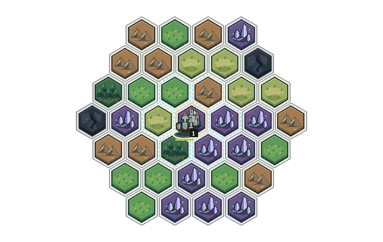
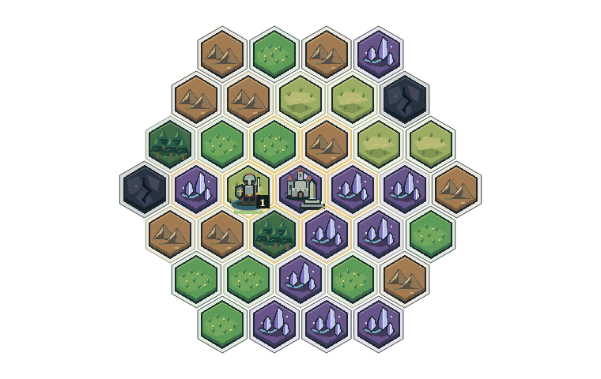

# 素材接続の検証記録

確認日: 2026-10-17（日本時間）
開始基準: main / f59804d8b6dfad75704bfa40024e148dee03391b

## 実装したもの

既存画像17点・既存SE8点・地上BGM1曲を接続し、自然拡張・保存・復元のSE3点を追加しました。全30素材のうち29点が現在のUIに接続されています。戦闘BGMは戦闘UI未実装のため未接続です。元の27素材・原稿・ジョブのバイト列は維持しています。

`src/ui/assets.js` がmanifestから画像を読み、読み込み失敗時は既存の地形色・城文字・部隊記号へフォールバックします。相対URLでサブディレクトリにも対応します。拡大は縦横同率の整数倍とnearest-neighborです。

`src/ui/audio.js` が操作結果のイベントから通知を選びます。購入・生産完成・移動・自然拡張・手番の優先順位で1音を鳴らし、拒否時はエラー音だけにします。保存・復元は成功した後の専用音です。履歴を読み直して過去の効果音を再生しません。

音声は初期ミュートで、利用者の入力からAudioContextを開始します。音量は0〜100%、BGMは主音量に対して0.4倍です。設定保存、非表示時の停止、SE同時4音までの制限、ミュート・曲切替・非表示後に遅れて完了した読み込みの無効化を実装しています。

## 実施した検証

- `npm test`: 32件成功。従来23件と、素材整合性・画像失敗・等方拡大・操作と効果音の対応・設定・音声の遅延読み込み競合に関する9件。
- `npm run check`: src・tests・toolsの全34 JavaScriptファイルの構文検査に成功。
- `npm run check:assets`: 全30点のファイルサイズ・SHA-256・PNG RGBA・音声復号・無音・クリッピング・ループ境界に成功。[今回の結果](../assets/verification-2026-10-17.json)。初回のverification.jsonは変更していません。
- 実UIコードをhappy-domとnative Canvasで実行。生産・購入成功/拒否・編成・選択・移動・Esc/ボタン解除・その後の領土購入・保存復元・不正JSON復元時のstate維持・音量保存・ミュート・新規開始を確認。[実行結果](../assets/qa/ui-smoke.json)。
- 平原画像を意図的に欠損させ、同じ操作を完了できることを確認。[画像欠損時の結果](../assets/qa/ui-missing-image.json)。
- ゲームのdrawMapそのものが出力したCanvasを目視。都市とPartyの重なり、人数・HP、選択輪郭、建設済みモニュメントを確認。





上の画像はゲームCanvasの出力です。ページ全体のブラウザスクリーンショットではありません。

## 未確認の範囲

この環境ではChromiumのサンドボックスが起動できず、非root起動も権限制約で失敗しました。ブラウザのサンドボックスを無効化して検査する方法は採用していません。

そのため、実ブラウザ上のCSSレイアウト・横スクロール、実AudioContextによるWAV/Ogg再生、ブラウザ別の再生開始制約、音声の人による聴取は未確認です。DOMテストのAudioContextはテストダブルであり、実音声出力を検証した意味ではありません。音声ファイル自体はFFmpegで復号・解析済みです。

manifestは `runtimeConnected: true` と `status: connected-candidate` で接続した事実を示します。最終確認を含む既存の `integrated` はfalseのままとし、`browserReviewed` と `humanListeningReviewed` もfalseを維持しています。未確認を完了扱いしません。

## 実ブラウザで残す確認手順

1. 通常の静的配信で起動し、地形6種・城・資源8種・生産の図が欠けないことを確認する。PC幅と狭い画面でページ外へはみ出さず、地図部分を横スクロールできることを確認する。
2. 初期状態で無音、音声ボタンを押すと地上BGM、音量0とミュートで停止することを確認する。設定を保存してもページ読み込み直後に勝手に音を出さないことを確認する。
3. 戦士購入→編成→移動→選択解除→領土購入→保存→ロード→新規開始を実行し、成功/拒否が別の音、選択と移動の音が区別できることを確認する。
4. モニュメント生産を進め、完成と自然領土拡張、保存と復元の音を聴く。完成と手番の重複通知がうるさくならないことを確認する。
5. 地上曲を少なくとも3周聴き、継ぎ目・繰り返し・SEとの音量差を確認する。別タブに移動して停止し、戻ったとき重複ループが生じないことを確認する。
6. 問題がある素材だけv002を制作し、manifestの採用版を切り替える。旧版を削除しない。問題がなければ確認環境と日付を記録し、最終確認フラグを更新する。

## 再実行

```sh
npm test
npm run check
npm run check:assets
```

DOM/Canvasハーネスはゲームの実行依存に追加していません。必要な場合だけ、別ディレクトリにQA用パッケージを入れて実行します。

```sh
npm install --prefix /tmp/kingdom-qa happy-dom @napi-rs/canvas
KINGDOM_QA_MODULES=/tmp/kingdom-qa/node_modules node tools/qa/ui-smoke.mjs /tmp/kingdom-ui-output
KINGDOM_QA_MODULES=/tmp/kingdom-qa/node_modules KINGDOM_QA_MISSING=terrain-plains node tools/qa/ui-smoke.mjs /tmp/kingdom-ui-missing
```

このハーネスでもCSS実レイアウト・ブラウザ互換性・聴取は確認できません。
