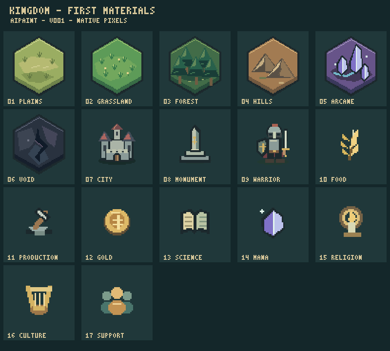

# Kingdom 初回素材プレビュー

制作・確認日: 2026-09-13 / v001

[制作一覧](./ASSET_LIST.md) を先にコミットした後、AIPaintで画像17点、AIMusicで効果音8点・BGM2曲を制作しました。全点はゲーム未接続の候補です。画像一覧を目視確認し、ファイル検査と音声解析を実施しました。音声の聴取とゲーム画面での動作確認は未実施です。

## 画像

一覧では地形・建物・戦士を2倍、アイコンを3倍で表示しています。PNG本体は透過です。陣営色・数値・選択状態は含めていません。

| No. | 素材 | 寸法 | PNG |
| --- | --- | --- | --- |
| 1 | 平原 | 64×64 | [terrain-plains](../assets/graphics/terrain-plains/v001/image.png) |
| 2 | 草原 | 64×64 | [terrain-grassland](../assets/graphics/terrain-grassland/v001/image.png) |
| 3 | 森林 | 64×64 | [terrain-forest](../assets/graphics/terrain-forest/v001/image.png) |
| 4 | 丘陵 | 64×64 | [terrain-hills](../assets/graphics/terrain-hills/v001/image.png) |
| 5 | 霊脈 | 64×64 | [terrain-arcane](../assets/graphics/terrain-arcane/v001/image.png) |
| 6 | 虚無 | 64×64 | [terrain-void](../assets/graphics/terrain-void/v001/image.png) |
| 7 | 都市 | 48×48 | [building-city](../assets/graphics/building-city/v001/image.png) |
| 8 | モニュメント | 48×48 | [building-monument](../assets/graphics/building-monument/v001/image.png) |
| 9 | 戦士 | 48×48 | [unit-warrior](../assets/graphics/unit-warrior/v001/image.png) |
| 10 | 食料 | 24×24 | [icon-food](../assets/graphics/icon-food/v001/image.png) |
| 11 | 生産 | 24×24 | [icon-production](../assets/graphics/icon-production/v001/image.png) |
| 12 | Gold | 24×24 | [icon-gold](../assets/graphics/icon-gold/v001/image.png) |
| 13 | 科学 | 24×24 | [icon-science](../assets/graphics/icon-science/v001/image.png) |
| 14 | mana | 24×24 | [icon-mana](../assets/graphics/icon-mana/v001/image.png) |
| 15 | 宗教 | 24×24 | [icon-religion](../assets/graphics/icon-religion/v001/image.png) |
| 16 | 文化 | 24×24 | [icon-culture](../assets/graphics/icon-culture/v001/image.png) |
| 17 | 人心 | 24×24 | [icon-popular-support](../assets/graphics/icon-popular-support/v001/image.png) |

## 音声

44.1kHz・ステレオです。GitHub上で再生UIが表示されない場合はリンク先からファイルをダウンロードして再生できます。

| 用途・曲名 | 長さ | 形式 | 音声 |
| --- | --- | --- | --- |
| 選択 | 0.184秒 | WAV／単発 | [se-ui-select](../assets/audio/se-ui-select/v001/audio.wav) |
| 確定 | 0.302秒 | WAV／単発 | [se-ui-confirm](../assets/audio/se-ui-confirm/v001/audio.wav) |
| 戻る | 0.274秒 | WAV／単発 | [se-ui-cancel](../assets/audio/se-ui-cancel/v001/audio.wav) |
| 操作不可 | 0.205秒 | WAV／単発 | [se-ui-error](../assets/audio/se-ui-error/v001/audio.wav) |
| 新しい手番 | 0.839秒 | WAV／単発 | [se-turn-start](../assets/audio/se-turn-start/v001/audio.wav) |
| 完成 | 0.894秒 | WAV／単発 | [se-production-complete](../assets/audio/se-production-complete/v001/audio.wav) |
| 購入 | 0.574秒 | WAV／単発 | [se-purchase](../assets/audio/se-purchase/v001/audio.wav) |
| 足取り | 0.253秒 | WAV／単発 | [se-party-move](../assets/audio/se-party-move/v001/audio.wav) |
| 暁の王領 | 17.778秒 | Ogg／8小節ループ | [bgm-overworld](../assets/audio/bgm-overworld/v001/audio.ogg) |
| 剣旗の進軍 | 13.333秒 | Ogg／8小節ループ | [bgm-battle](../assets/audio/bgm-battle/v001/audio.ogg) |

地上曲「暁の王領」は108 BPM、戦闘曲「剣旗の進軍」は144 BPMです。初回の短い8小節版で、長時間再生時の飽きやすさ・各SEとのバランスは聴取時に確認します。

## 原稿と検査

各PNGと同じフォルダにAIPaint原稿、各音声と同じフォルダにAIMusic原稿・MIDIがあります。[制作手順](../tools/assets/README.md) に再生成と編集方法を記載しています。

[manifest.json](../assets/manifest.json) は全27点の出典・ハッシュ・採用状態、[verification.json](../assets/verification.json) は復号検査の結果です。全ファイルのハッシュ、透過・寸法、音声の長さ・無音・非数値・クリッピング・BGM境界を検査して成功しました。聴取済み、ゲーム表示・再生済みの意味ではありません。
